

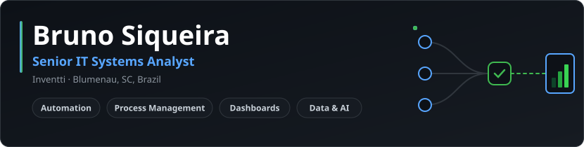

&nbsp;

## About me

Senior IT Systems Analyst at **Inventti**, working on **automation**, **process management** and
**administration**. I turn manual, repetitive work into reliable automated flows and make sure the
team has the processes, training and visibility to run them every day.

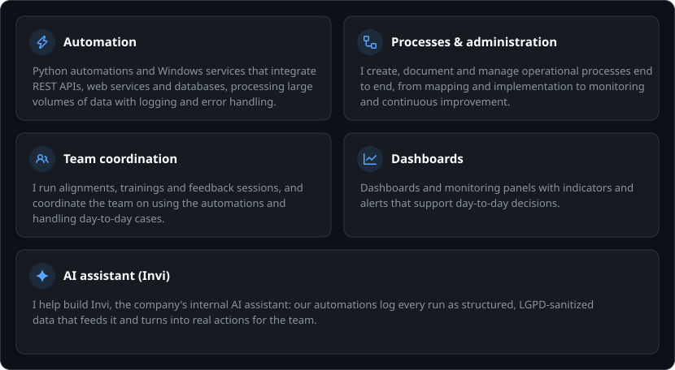

## Tech stack

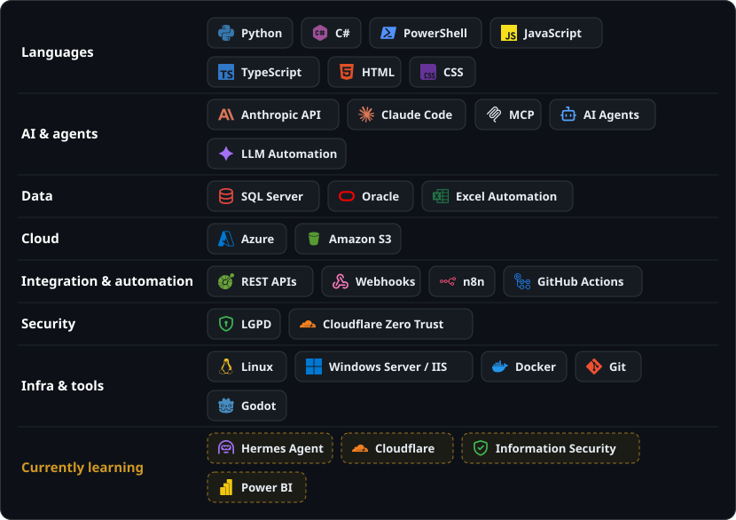

## Featured projects

<a href="https://github.com/brunosiqp/envy-converter">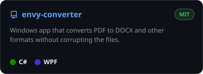</a>
<a href="https://github.com/brunosiqp/MegaQG-Vivo">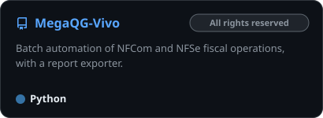</a>
<a href="https://github.com/brunosiqp/LongNameJanitor">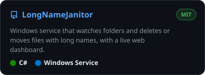</a>
<a href="https://github.com/brunosiqp/PDA">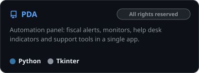</a>
<a href="https://github.com/brunosiqp/github-lang-stats">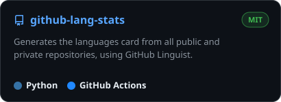</a>
<a href="https://github.com/brunosiqp/docker-n8n-project">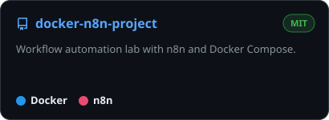</a>

See all projects in <a href="https://github.com/brunosiqp?tab=repositories">my repositories</a>.

## GitHub stats

  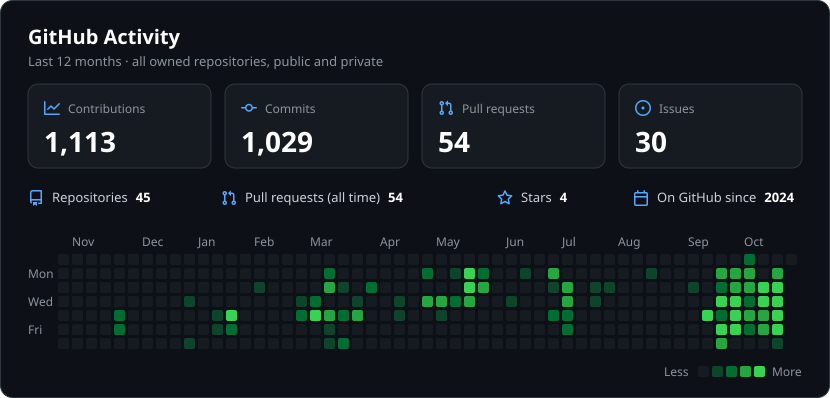
    
  

Both cards include private repositories and are updated automatically every day.

## Education

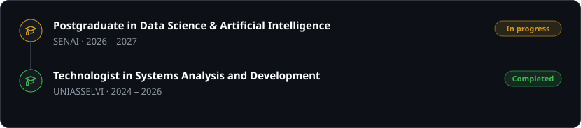

## Contact

Open to talking about automation, processes and data. Reach out on
[LinkedIn](https://www.linkedin.com/in/bruno-siqueira-b81312230/) or by
[email](mailto:b.s.parente@gmail.com).
